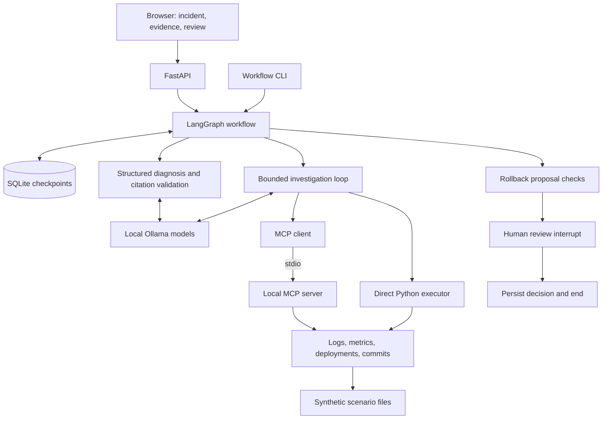
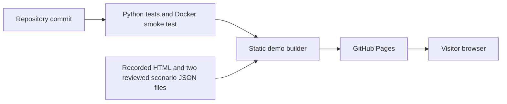

# OpsPilot

An evaluation-driven incident investigation application for the fictional Acme
Commerce platform. OpsPilot gathers operational evidence, generates a structured
diagnosis with citations, and persists proposed actions for human review.

**[Explore the recorded demo](https://abhigyan04.github.io/opspilot/)** ·
[Architecture](docs/architecture.md) ·
[Evaluation results](docs/grounding-baseline-results.md) ·
[Milestone status](docs/milestone-status.md)

## What it does

- Investigates synthetic incidents using logs, metrics, deployments, and commits.
- Selects tools with validated arguments through direct Python or local MCP.
- Produces structured diagnoses with clickable operational evidence citations.
- Persists LangGraph workflows and human review decisions in SQLite.
- Provides a responsive light/dark web UI, Docker deployment, and CI checks.
- Evaluates diagnosis grounding, retrieval, tool usage, and remediation controls.

The live workflow records approval or decline; **approval does not execute a
rollback**. A separate CLI supports in-memory remediation simulation and recovery
classification. No tools connect to production infrastructure.

## Recorded demo

The [public site](https://abhigyan04.github.io/opspilot/) lets visitors inspect two
saved investigations without installing models:

| Scenario | Recorded outcome | What to inspect |
|---|---|---|
| Checkout regression | Rollback proposal declined | Code change, logs, deployment, and metric citations |
| Payment-provider outage | No action proposed | Dependency failures observed before deployment |

The site serves static HTML and two reviewed JSON assets. It makes no live model
calls and cannot create workflows, change review decisions, or execute actions.
Review notes identify known limitations without rewriting original model output.
The working local application is separate and supports live investigations.

## Architecture

### Local investigation and human review



The graph runs `prepare → investigate → diagnose → propose`. It ends immediately
when no proposal is available; otherwise it pauses for review and ends after the
decision. SQLite checkpoints preserve state across process and container restarts.
The investigation loop remains bounded by a model-decision limit.

### Recorded demo deployment



GitHub Actions deploys the static bundle after tests and the container smoke test
succeed on pushes to `master`. The local Docker application uses host Ollama and
a named checkpoint volume; GitHub Pages hosts neither the API nor inference.

## Safety and grounding boundaries

| Control | What it establishes | What it does not establish |
|---|---|---|
| Pydantic tool schemas | Allowed tools and valid argument structure | Evidence supporting every argument value |
| Evidence IDs and runtime citation checks | Citations refer to collected responses | Every attached claim is semantically supported |
| Deterministic timing payloads | Calculated deployment-to-log/sample relationships | Exact incident onset or causation |
| Proposal checks and review interrupt | A decision is bound to the pending proposal | Execution of a rollback |
| SQLite checkpoints | Persistent investigation and review state | Distributed execution or exactly-once actions |

The local API has no authentication and is intended for loopback use with one
application worker. `/health` reports liveness, not model readiness. Investigation
requests wait for completion; there is no background job queue.

Optional retrieval uses synthetic runbooks and historical incidents, embedding
provenance, and local vectors or PostgreSQL/pgvector. It is available through
opt-in diagnosis replay, not the live web workflow. The small recorded comparison
did not establish an overall benefit from references, so they remain optional.
See the [RAG review](docs/milestone-9-review.md) and
[full architecture](docs/architecture.md) for the separate execution paths.

## Quickstart: local web application

The commands below target **Windows PowerShell with Docker Desktop using Linux
containers**. Install Docker Desktop and Ollama, and keep Ollama running on the
host. Download both models before starting an investigation:

```powershell
git clone https://github.com/abhigyan04/opspilot.git
Set-Location opspilot
ollama pull qwen3:4b
ollama pull qwen3:8b
docker compose up -d --build --wait app
Invoke-RestMethod http://127.0.0.1:8001/health
```

Open **http://127.0.0.1:8001**. Enter an incident such as:

> Errors in checkout-service have increased significantly. Investigate.

Choose checkout regression, payment-provider outage, or sparse evidence, then
select Direct Python or Local MCP. Investigation may take several minutes;
keep the page open until the result appears. Inspect citations and any proposal
before recording a review decision. Save the workflow ID to reload it later.

Compose connects to Ollama at `http://host.docker.internal:11434`. To check model
connectivity separately from application health:

```powershell
docker compose exec -T app python -c "from ollama import Client; print(Client(timeout=10).list())"
```

Checkpoints live in the `workflow_data` named volume. Recreating the app container
preserves that volume. `docker compose down` retains volumes by default;
`docker compose down -v` deletes them and their stored workflows.
PostgreSQL is not required for this web workflow.

### Run without Docker

Use Python 3.11 or newer (CI and the container use Python 3.12), with the same
Ollama models installed and running:

```powershell
python -m venv .venv
.\.venv\Scripts\python.exe -m pip install -e ".[dev]"
.\.venv\Scripts\python.exe -m uvicorn app.main:app --host 127.0.0.1 --port 8000
```

Open **http://127.0.0.1:8000**. Native execution uses the local checkpoint file
under `out/workflows/`; it does not share Docker's named volume automatically.
For a revision-pinned walkthrough, see the
[reproducible demo guide](docs/milestone-12-demo.md).

### Runtime configuration

[`.env.example`](.env.example) lists validated model, target-service, step-limit,
and workflow generation defaults, centralized in `app/agent/settings.py`.
For native execution, set process variables before starting Python, for example:

```powershell
$env:OPSPILOT_INVESTIGATION_MODEL = "qwen3:8b"
$env:OPSPILOT_WORKFLOW_DIAGNOSIS_MODEL = "qwen3:8b"
$env:OPSPILOT_SERVICE = "checkout-service"
```

Python does not automatically load `.env`. Compose reads `.env` and forwards the
listed settings; recreate the app container after changes. Explicit function or
CLI model arguments override defaults. The API captures settings at startup;
restart it to change them. New checkpoints save resolved models, service, limits,
and diagnosis settings; resumed workflows use that saved configuration.
Version-4 checkpoints retain their original `qwen3:4b` investigation model.
Service configuration selects the proposal target; it does not rename synthetic
fixtures or replace the service described in the incident. Per-request model
overrides are not exposed by `StartWorkflowRequest`.

## Evaluation snapshot

The diagnosis-only baseline contains **nine completed replays**: three fixed
saved investigations, each replayed with seeds 42, 43, and 44 using `qwen3:8b`.
References were disabled; context was 8192 and generation was capped at 2048.
The results below are **Codex AI assessments, not independent human validation**.

Each cell reports **met / assessable** under the documented review criteria.

| Scenario | Causal explanation | Deployment reasoning | Evidence grounding | Uncertainty handling |
|---|---|---|---|---|
| Checkout regression | 3/3 | 2/3 | 0/3 | 3/3 |
| Provider outage | 3/3 | 3/3 | 2/3 | 2/3 |
| Sparse evidence | Not assessable | Not assessable | 3/3 | 3/3 |

The baseline exposes incomplete claim citations and a deployment-timing error:
one checkout output said seven minutes where timestamps show eight. A subsequent
change supplies calculated deployment-to-metric intervals and source IDs; the
matched model rerun is still pending, so no grounding improvement is claimed.

These familiar synthetic cases measure diagnosis on fixed evidence, not held-out
accuracy, investigation quality, or end-to-end production performance. Per-case
mean diagnosis times ranged from 16.09 to 24.49 seconds in this small local batch;
warm-up and hardware utilization were not controlled. They are not p95 estimates.

The [full results](docs/grounding-baseline-results.md) link all nine preserved
reports, hashes, review rationales, and configuration. See the
[evaluation plan](docs/evaluation-plan.md) for scoring criteria and the
[run procedure](docs/grounding-baseline-run.md) for input/provenance requirements.
The procedure currently needs saved source reports under ignored `out/` paths;
those original source files are not supplied by a fresh clone.

## Tests and CI

```powershell
.\.venv\Scripts\python.exe -m pytest -q
```

Latest verified local result for commit `f185f80`: **732 passed, 22 skipped**.
The skipped checks require an explicitly configured PostgreSQL test database.
Unit and integration checks validate software behavior; their pass count is not
a measure of model diagnosis accuracy.

[CI run 40498790793](https://github.com/abhigyan04/opspilot/actions/runs/40498790793)
passed Python tests, Docker smoke checks, and recorded-demo deployment for
`f185f804f8e5d9e5ddb78239b26d6f9b36093a6a`. This is verification for that revision,
not an assertion that every later commit has passed CI.

The Docker smoke check covers HTTP health, UI delivery, packaged fixtures,
non-root execution, and writable checkpoint storage. It does not call a model.
The [CI workflow](.github/workflows/ci.yml) defines the checks and Pages deployment.

## Further documentation

- [Architecture and code map](docs/architecture.md)
- [Current milestone status](docs/milestone-status.md)
- [Grounding baseline and preserved evidence](docs/grounding-baseline-results.md)
- [Historical evaluation baseline](docs/milestone-8-baseline.md)
- [RAG review](docs/milestone-9-review.md)
- [MCP review](docs/milestone-10-review.md)
- [Persisted workflow review](docs/milestone-11-review.md)
- [UI and deployment review](docs/milestone-12-review.md)
- [Detailed engineering history and CLI recipes](docs/milestones/README.md)

The next engineering step is a matched nine-replay evaluation of the timing
change, preserving the original baseline and checking for regressions across all
four review criteria. Durable action execution and recovery verification within
the persisted graph remain future work.
