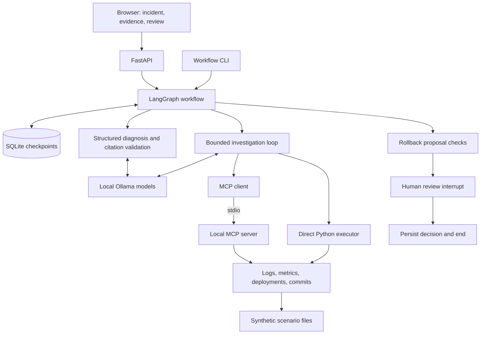
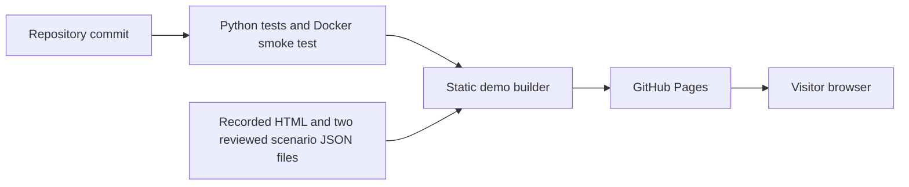

# OpsPilot architecture

OpsPilot investigates synthetic service incidents, produces diagnoses with
evidence citations, and persists proposed actions for human review. I built the
live application for local use and published a separate recorded demo so visitors
can inspect its outputs without running models or paying for inference.

## Live application

The graph runs `prepare → investigate → diagnose → propose`. It ends immediately
when no action is proposed; otherwise it pauses for review and ends after the
decision. Approval in this workflow does not execute a rollback.

- **Investigation:** the model chooses tools and arguments within a step limit.
  Pydantic validates arguments before dispatch. Each tool response receives an
  evidence ID, including empty responses.
- **Diagnosis:** a separate model call receives the operational observations.
  Generation constraints and runtime checks restrict citations to collected
  evidence IDs. These checks establish reference membership, not causal truth.
- **Proposal and review:** deterministic checks determine whether to offer a
  rollback candidate. A review must match the pending proposal. Terminal or
  stale reviews are rejected.
- **Persistence:** SQLite stores graph checkpoints across process and container
  restarts. The workflow CLI also supports retrying supported failed stages.
  The HTTP interface does not expose that retry path.

The browser sends requests to FastAPI to start, inspect, or review workflows.
Starting an investigation waits for model work to finish; there is no background
job queue. The application uses a review lock within one process and is intended
to run with one application worker.

## Optional retrieval and evaluation

The retrieval pipeline loads a catalog of synthetic runbooks and historical
incidents, chunks their content, and embeds passages with EmbeddingGemma.
Embedding identity and document provenance accompany persisted indexes.
Search supports local vectors and PostgreSQL with pgvector.

Diagnosis replay can retrieve reference passages and supply them separately from
operational evidence. Reference notes use a separate citation namespace. This
path is opt-in and is not connected to the live web workflow. The small recorded
comparison did not establish an overall quality benefit from references; see the
[milestone 9 review](milestone-9-review.md).

The evaluation tools cover tool usage, evidence, diagnosis review, retrieval,
remediation appropriateness, safety controls, latency, and recorded model usage.
Historical results have different scopes and model settings. They do not form a
single current end-to-end accuracy score.

The earlier agent CLI provides a separate in-memory remediation simulation and
recovery classification over synthetic fixtures. It is not a production action
executor and is not a continuation of the persisted web review graph.

## Deployment and public demo

The local Docker application runs as a non-root user, serves the UI on loopback
port 8001, and stores checkpoints in a named volume. On Docker Desktop it reaches
host Ollama through `host.docker.internal`. PostgreSQL is a separate Compose
service for retrieval work, not the workflow checkpoint store.

The [public demo](https://abhigyan04.github.io/opspilot/) serves only static HTML
and two recorded synthetic workflow assets. Its build uses an explicit file list.
It cannot call models, create workflows, record approvals, or execute actions.
GitHub Actions builds and deploys that bundle after the test and Docker jobs
succeed on pushes to `master`.

## Boundaries and tradeoffs

- The local API has no authentication or production TLS setup; it is not a
  publicly hosted service.
- Tools read synthetic fixtures rather than production observability systems.
- Schema and citation validation do not eliminate unsupported reasoning or
  timing mistakes. Recorded demo review notes preserve known limitations.
- `/health` checks application liveness, not model or database readiness.
- Durable action execution, recovery verification in the graph, distributed
  review coordination, and background jobs remain future work.
- Plain HTML and JavaScript keep the demo small. The live and recorded pages
  share presentation patterns but currently duplicate some rendering and styles.

## Code map

| Responsibility | Location |
|---|---|
| HTTP routes and application factory | `app/main.py` |
| API input schemas | `app/api/schemas.py` |
| Persisted workflow and review interrupt | `app/agent/workflow.py` |
| Workflow CLI and SQLite lifecycle | `app/agent/workflow_cli.py` |
| Investigation and diagnosis | `app/agent/agent.py` |
| MCP transport | `app/mcp_server/` |
| Scenario tools | `app/tools/` |
| Retrieval and provenance | `app/retrieval/` |
| Evaluation and replay | `evals/` |
| Live and recorded pages | `app/web/index.html`, `app/web/demo.html` |
| Static bundle builder | `scripts/build_demo.py` |
| Test, container, and Pages automation | `.github/workflows/ci.yml` |
